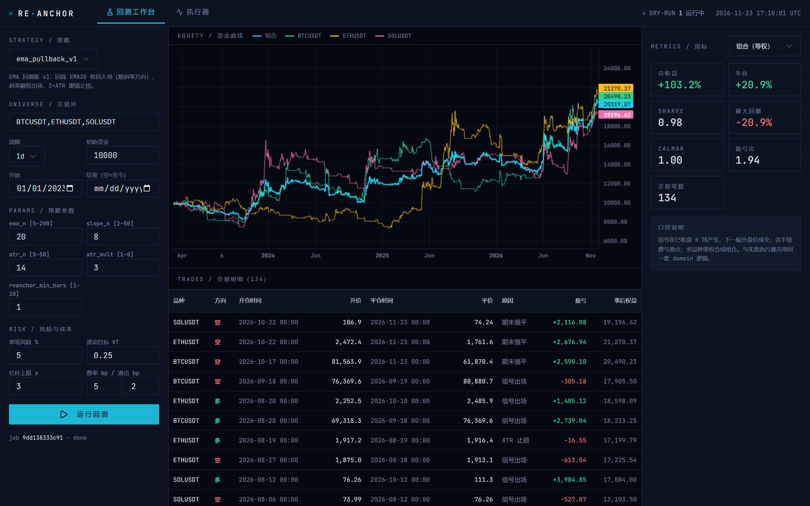
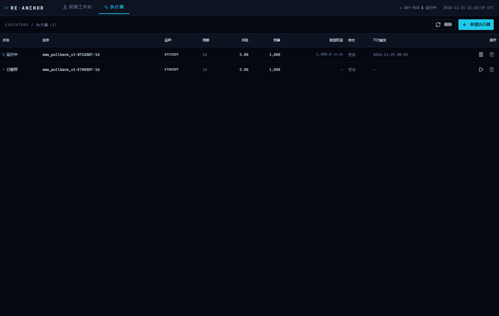
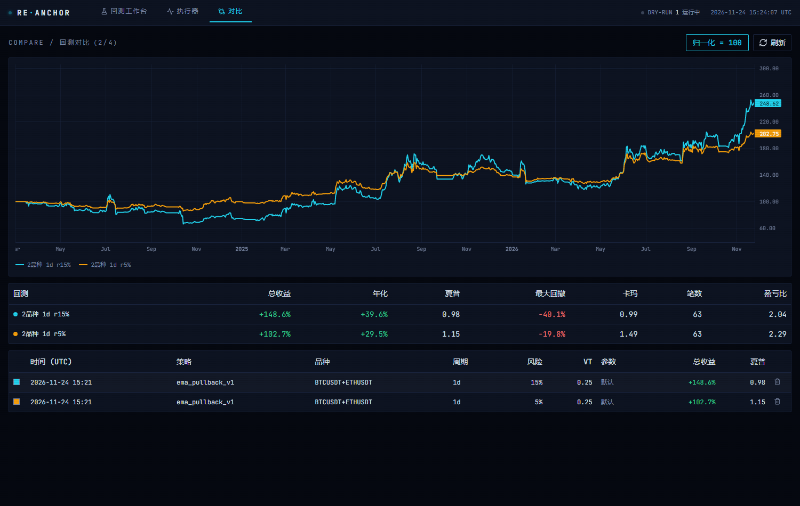

<div align="center">

# ⚓ ReAnchor

**合约量化交易平台 —— 回测、实盘执行与策略研究的一体化工作台**

基于 Python + FastAPI 的后端，React + TypeScript 的暗色终端风前端。
名字来自策略的签名机制：ATR 重锚止损（[`ReanchorStop`](backend/app/domain/sizing.py)）。


-22d3ee)

</div>

---

## 为什么叫 ReAnchor

趋势跟踪策略最微妙的部分不是入场，而是**止损如何跟随趋势**。
本平台的内置策略以「ATR 重锚」机制为核心：持仓期间按收盘价 ∓ 3×ATR 持续重锚止损线，
斜率同向满 N 根后切换为棘轮锚定——这套规则经过完整的研究回测验证，
并被逐条移植为平台代码（见下文「回测保真」）。

## ✨ 特性

- **事件驱动回测引擎**：信号在已收盘 K 线上产生、下一根开盘成交，盘中用 high/low 保守判定止损，从机制上杜绝前视偏差
- **执行器（Executor）模型**：策略是内置模板，执行器持有参数配置独立运行；bar 收盘触发，连续失败自动熔断（只停自己，不拖累其他执行器）
- **回测 / 实盘语义一致**：同一套信号逻辑、同一套 `ReanchorStop`，回测引擎与实盘 runner 共享 domain 层
- **Dry-run 优先**：实盘默认全 dry-run，真实下单刻意保留 `NotImplementedError`，需要显式开关
- **终端风工作台**：暗色主题、等宽数字、lightweight-charts 权益曲线、交易明细逐笔可查
- **多交易所架构**：交易所适配器抽象层，一期接入 Gate.io（ccxt）

## 🖥 界面

| 回测工作台 | 执行器管理 |
|---|---|
|  |  |
| 三品种等权组合回测：权益曲线、指标面板、逐笔交易明细 | 执行器状态机：启停、下次触发、账面权益与持仓一览 |

| 回测对比 |
|---|
|  |
| 多次回测存档叠加对比：归一化净值曲线 + 收益/夏普/回撤指标表 |

## 🚀 快速开始

```bash
# 后端（Python 3.12+）
cd backend
pip install -r requirements.txt
PYTHONPATH=. uvicorn app.main:app --reload --port 8000
# API 文档: http://localhost:8000/docs

# 前端（Node 20+）
cd frontend
npm install
npm run dev        # http://localhost:3000（/api 已代理到 8000）
```

或使用 Docker Compose 整体启动：

```bash
docker-compose up  # 后端 :8000 / 前端 :5173
```

## 🧪 测试与回测保真

```bash
cd backend
PYTHONPATH=. python tests/test_engine_smoke.py   # 引擎冒烟 + 研究基线锚定
PYTHONPATH=. python tests/test_executors.py      # 执行器 CRUD / 状态机
PYTHONPATH=. python tests/test_live_runner.py    # 实盘调度 / 熔断
```

引擎结果**锚定研究基线**（BTC 日线，5% 风险 + VT 25%），防止移植漂移
（完整研究过程见 [docs/EMA_Slope_Trend_Strategy_Paper.pdf](docs/EMA_Slope_Trend_Strategy_Paper.pdf)）：

| 策略变体 | 研究基准年化 | 容差 |
|---|---|---|
| v1 每根重锚 | +23.4% | ±3pp |
| v2 满 3 根棘轮重锚 | +25.1% | ±3pp |

任何对信号、仓位或止损逻辑的意外改动都会让测试直接变红。

## 📦 内置策略

**EMA 回调版 v1**（`ema_pullback_v1`）：回踩 EMA20 收回后顺斜率方向入场，斜率翻转出场，3×ATR 重锚止损。

| 参数 | 默认 | 范围 | 说明 |
|---|---|---|---|
| `ema_n` | 20 | 5–200 | EMA 周期 |
| `slope_k` | 8 | 2–50 | 斜率回溯窗口 |
| `atr_n` | 14 | 5–50 | ATR 周期 |
| `atr_mult` | 3.0 | 1.0–8.0 | 止损 ATR 倍数 |
| `reanchor_min_bars` | 1 | 1–10 | 重锚模式：1=v1 每根重锚；≥2=v2 同向满 N 根棘轮锚定 |

新策略实现 `prepare / entry_signal / exit_signal / on_bar` 四个方法即可接入回测与实盘（见 [`domain/strategy.py`](backend/app/domain/strategy.py)）。

## 🗂 目录结构

```
reanchor/
├── backend/                # FastAPI 后端
│   ├── app/
│   │   ├── api/v1/         # REST 路由（回测 / 执行器 / 策略 / 行情）
│   │   ├── core/           # 配置与安全
│   │   ├── domain/         # 策略接口、仓位管理、ReanchorStop（纯逻辑，无 IO）
│   │   ├── services/       # 回测引擎、执行器调度、实盘 runner
│   │   ├── strategies/     # 内置策略
│   │   └── infrastructure/ # 交易所适配器（Gate.io/ccxt）、SQLite 持久化
│   └── tests/
├── frontend/               # React + Vite + shadcn/ui（回测工作台 + 执行器管理）
├── docs/                   # 技术设计文档（Mermaid 架构/时序图）+ 策略研究论文（PDF）
│   └── research/           # 研究归档：论文数字的可复现脚本与数据
└── docker-compose.yml
```

详细架构、数据流与时序图见 **[docs/technical-design.md](docs/technical-design.md)**。

## ⚙️ 配置

后端通过环境变量配置（`TP_` 前缀）：

| 变量 | 默认 | 说明 |
|---|---|---|
| `TP_LIVE_ENABLED` | `false` | 实盘总开关；关闭时所有订单 dry-run |
| `TP_GATE_API_KEY` / `TP_GATE_API_SECRET` | 空 | Gate.io API 凭证 |
| `TP_GATE_SANDBOX` | `false` | 使用 Gate 测试网 |

## 🗺 Roadmap

- [x] 一期：回测引擎 + 执行器 + 终端风工作台（dry-run 实盘）
- [ ] 真实下单（Gate.io 合约，显式开关 + 二次确认）
- [ ] 二期：AI Agent 交易助手（对话式策略分析、监控与调参建议）
- [ ] 多策略并行与组合层净值

## ⚠️ 免责声明

本项目仅用于量化研究与教育目的。加密货币合约交易具有极高风险，
回测表现不代表未来收益，使用本项目进行实盘交易的一切后果由使用者自行承担。
