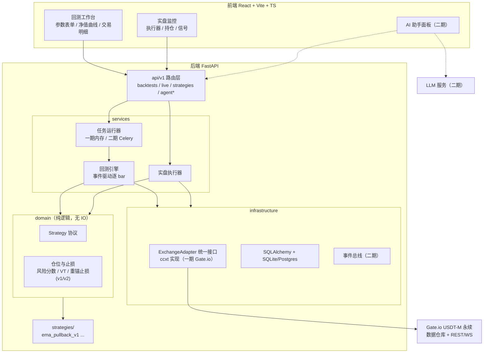
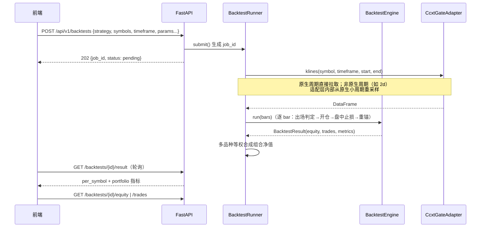
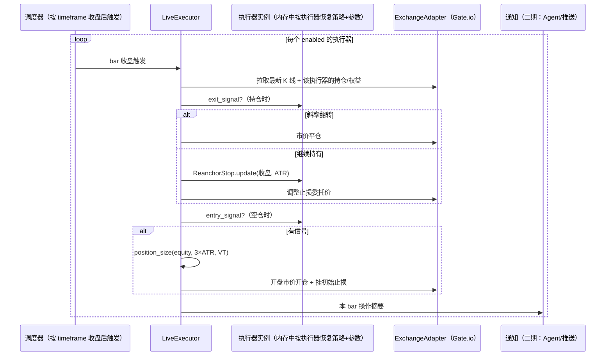
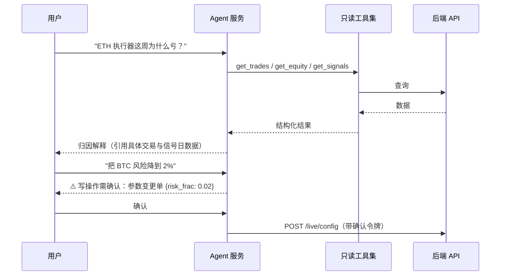
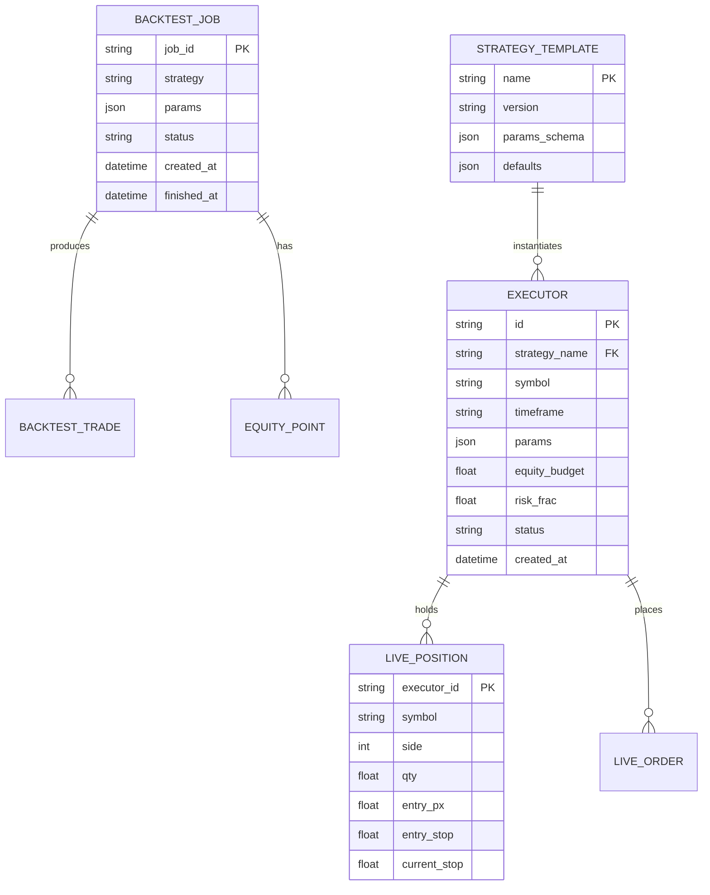

# 技术设计文档：ReAnchor 合约量化交易平台

> 版本 0.3（一期骨架）· 2026-11
> 范围：一期 = 回测 + 实盘执行；二期 = AI Agent 交易助手
> v0.2 变更：K 线周期最小支持到 1min；交易所适配层改为 Gate.io 优先，基于 ccxt 实现统一接口
> v0.3 变更：项目定名 ReAnchor；重锚止损支持 v1/v2 双模式（`reanchor_min_bars`）；研究论文归档至 docs/
>
> 研究依据：内置策略的完整研究过程（信号定义、参数扫描、跨品种验证、风险缩放、
> ATR 重锚 v0/v1/v2 对比）见 **[EMA_Slope_Trend_Strategy_Paper.pdf](EMA_Slope_Trend_Strategy_Paper.pdf)**，
> 本文档中的执行语义均与该论文的回测口径一一对应。

---

## 1. 设计目标与非目标

**目标**
1. 回测与实盘**共用同一份策略代码与执行语义**（信号在已收盘 K 线产生、下一根开盘价成交）——研究阶段最大的教训是回测口径漂移，平台从架构上消除它；
2. 策略可插拔：实现 4 个方法即可接入回测、实盘与未来的参数扫描；
3. 实盘默认安全：逐仓、3x 杠杆上限、dry-run 默认、实盘总开关默认关闭；
4. 二期 AI Agent 以只读工具起步（查询/解释/监控），写操作（下单/改参数）必须人工确认。

**非目标（一期）**
- 多用户与权限体系（单用户自用）；
- 高频/tick 级策略（引擎按 bar 驱动，最低 1min 周期；1min 已是平台能力下限，不代表已验证策略可下放到该周期）；
- 多交易所**并行接入**（适配层一期即按多交易所统一接口设计，但只实装 Gate.io USDT-M 永续）。

## 2. 总体架构



关键约束：**回测引擎与实盘执行器都只依赖 `domain` 层**，策略不知道自己跑在回测还是实盘里——这保证研究验证过的行为在线上逐字重现。

## 3. 后端分层与模块职责

```
backend/app/
├── api/v1/            # 只做参数校验与响应组装，无业务逻辑
├── core/              # Settings（TP_ 前缀环境变量）
├── domain/            # 纯逻辑：Strategy 协议、SizingConfig、ReanchorStop
├── strategies/        # 策略实现（prepare / entry_signal / exit_signal / on_bar）
├── services/          # BacktestEngine / BacktestRunner / LiveExecutor
└── infrastructure/    # ExchangeAdapter 统一接口 + ccxt 实现（Gate.io）、持久化、事件总线
```

### 3.0 交易所适配层（infrastructure/exchange.py）

平台定义自己的最小统一接口（Port），底层用 **ccxt.async_support** 实现（Adapter），避免与任何一家交易所的 API 耦合：

```python
class ExchangeAdapter(Protocol):
    async def klines(self, symbol, timeframe, start, end) -> DataFrame   # 统一返回 UTC ms 时间戳 OHLCV
    async def place_order(self, symbol, side, qty, *, dry_run) -> OrderResult
    async def set_stop(self, symbol, stop_px) -> None
    async def get_position(self, symbol) -> Position | None
    async def get_equity(self) -> float
```

- 一期实现 `CcxtGateAdapter`（ccxt 的 `gate` 交易所 id，合约用 `defaultType: "swap"`）；
- 接入新交易所 = 新增一个 ccxt 交易所 id 的配置，接口不变；
- 选 ccxt 而非裸封装 Gate.io REST：统一接口与鉴权已由 ccxt 维护，我们不重写轮子；ccxt 的坑（各交易所字段差异、限频）被隔离在适配层内部，domain/services 永远只看到平台的统一模型。

**K 线周期支持**：`1m 5m 15m 30m 1h 2h 4h 6h 8h 12h 1d 2d 1w`。交易所原生支持的周期直接拉取（Gate.io 支持 1m–1d），非原生周期（如 2d）由适配层从最近的原生小周期重采样——重采样逻辑在适配层内完成，回测引擎拿到的永远是目标周期的完整 K 线。注意 1m 长区间数据量大（3 年 ≈ 160 万根），回测任务按 `(symbol, timeframe, start, end)` 做本地 parquet 缓存。

### 3.1 策略与执行器（核心概念模型）

**策略（Strategy）是内置的无状态模板，执行器（Executor）是用户从策略创建的运行时实例**：

```
策略模板（代码内置，注册表管理）
  │  定义：信号逻辑 + 参数 schema + 默认值
  ▼  用户实例化：选策略 → 填参数 → 绑品种/资金
执行器 Executor（持久化，平台核心实体）
  │  持有：strategy_name、params（覆盖默认值）、symbol、timeframe、
  │        风险预算（equity 上限 / risk_frac）、enabled
  ▼  生命周期：created → running ⇄ paused → stopped
回测 = 执行器配置的一次性运行（不建持久实体，用完即弃）
实盘 = 执行器的持续运行（持仓、止损、权益都挂在执行器名下）
```

这样设计的好处：同一个策略可以实例化出"BTC 保守版（风险 2%）"和"ETH 进取版（风险 5%）"两个执行器，参数互不影响；回测与实盘共用"执行器配置"这一概念，回测参数就是未来实盘执行器的参数，从研究到上线没有第二次翻译。

### 3.2 策略协议（domain/strategy.py）

```python
class Strategy(Protocol):
    name: str
    def prepare(self, bars, params) -> DataFrame          # 指标预计算（无未来函数）
    def entry_signal(self, bars, t, params) -> int        # 用 t-1 判定，返回 ±1/0
    def exit_signal(self, bars, t, pos_side, params) -> bool
    def on_bar(self, ctx) -> None                          # 实盘钩子
```

**防前视纪律写入协议**：`entry_signal(bars, t)` 的契约是"只能读 `bars.iloc[:t]`"。引擎在 bar t 开盘价成交，信号全部来自 t-1。代码评审时任何 `iloc[t]` 出现在信号函数里都是拒绝项。

### 3.3 仓位与止损（domain/sizing.py）

与验证研究的规则逐条对应：

```
risk = equity × risk_frac × vt_scalar          # vt_scalar = clamp(VT/σ_20d, 0.25, 2.5)
qty  = min(risk / (3×ATR14), equity × 3x / price)
止损 = ReanchorStop：ATR 重锚，两种模式由 reanchor_min_bars 选择
```

**重锚止损双模式**（`ReanchorStop`，由回测引擎与实盘 runner 共享）：

- **v1（`reanchor_min_bars=1`，默认）**：每根收盘以 收盘 ∓ mult×ATR 重新锚定，
  多头 `max(初始止损, close−dist)`、空头镜像。是「重锚」而非棘轮——回撤后锚点会随新收盘回落；
- **v2（`reanchor_min_bars≥2`）**：斜率与持仓同向连续满 N 根前做峰值跟踪棘轮，
  满 N 根后多头取 `max(stop, close−dist, peak−dist)`、空头取 `min(stop, close+dist)`，
  全程棘轮只进不退。入场即计 1 根同向（入场信号本身要求斜率同向），与研究脚本计数对齐。
  注意多头含峰值锚项、空头不含——这是研究脚本的原样行为，平台如实复刻。

冒烟测试 `tests/test_engine_smoke.py` 同时锚定两条研究基线（BTC 日线：v1 年化 +23.4%±3pp、
v2 年化 +25.1%±3pp），任何信号/仓位/止损逻辑的意外改动都会直接变红。

## 4. 核心流程时序

### 4.1 回测任务



### 4.2 实盘执行循环（一期：按周期收盘后触发）

实盘不需要实时撮合——**在每根 K 线收盘后触发一次信号循环**，与策略周期匹配。日线策略每日 00:05 UTC 跑一次即可；1min 级别策略则每分钟收盘后触发（一期用 REST 轮询确认收盘，二期再评估 WebSocket 推送）。



调度实现：APScheduler 按执行器 timeframe 注册 cron（1min → `* * * * *` 偏移 5 秒；1d → 每日 00:05 UTC）。同一进程内多个执行器串行执行，避免触发交易所限频（Gate.io 合约 REST 约 10 次/秒/账户，批量操作间加 ccxt 的 rate limiter）。

安全闸（一期硬编码）：`TP_LIVE_ENABLED=false` 时所有下单强制 dry_run；单笔名义价值 > 权益×3 拒绝；连续 3 次下单失败自动暂停该执行器并告警（不影响其他执行器）。

### 4.3 二期：AI Agent 交易助手



二期的架构要点：Agent 的工具集复用一期 API；**读操作自由，写操作出确认单**——与实盘安全闸同一套哲学。

## 5. 数据模型（一期最小集）



执行器的权益核算：单用户单交易所账户下，多个执行器共享一个 Gate.io 合约账户，按 `equity_budget` 做**账面隔离**——每个执行器记账自己的权益曲线与持仓，平台保证 Σ(执行器风险敞口) ≤ 账户总权益 × 3x 杠杆硬顶。

一期可用 SQLite（`TP_DATABASE_URL`），迁移 Postgres 仅换连接串。

## 6. API 一览（一期）

| 方法 | 路径 | 说明 |
|---|---|---|
| POST | `/api/v1/backtests` | 提交回测（异步任务） |
| GET | `/api/v1/backtests/{id}` | 任务状态 |
| GET | `/api/v1/backtests/{id}/result` | 指标汇总（分品种 + 组合） |
| GET | `/api/v1/backtests/{id}/equity` | 净值曲线 |
| GET | `/api/v1/backtests/{id}/trades` | 交易明细 |
| GET | `/api/v1/strategies` | 策略模板列表与参数 schema |
| POST | `/api/v1/executors` | 从策略模板创建执行器（symbol/timeframe/params/风险预算） |
| GET | `/api/v1/executors` | 执行器列表（含持仓与权益快照） |
| PATCH | `/api/v1/executors/{id}` | 改参数 / 启停（running ⇄ paused） |
| DELETE | `/api/v1/executors/{id}` | 停止并平仓（需显式 confirm） |
| GET | `/api/v1/executors/{id}/signals` | 该执行器最近信号流水 |
| GET | `/api/v1/live/status` | 实盘总状态 |
| POST | `/api/v1/live/orders` | 手动下单（默认 dry_run） |

## 7. 关键决策记录

| # | 决策 | 理由 |
|---|---|---|
| 1 | 回测与实盘共用 domain 层 | 研究阶段的最大风险是回测/实盘行为漂移，架构上强制同源 |
| 2 | 信号只用已收盘 K 线，下一根开盘价成交 | 防前视偏差；已在研究中验证此口径下策略仍盈利 |
| 3 | 实盘按"K 线收盘后触发"而非实时流 | 与策略周期匹配，从 1min 到 1d 同一套机制；二期再评估 WebSocket |
| 4 | dry_run 默认 + 总开关 + 杠杆硬顶 | 实盘错误的代价不对称，宁可麻烦不可裸奔 |
| 5 | 策略参数集中到 StrategyParams | 平台扫描/滚动起点检验等研究流程可以直接在平台上复现 |
| 6 | 一期内存任务表，接口按 Celery 可替换设计 | 单机自用足够；asyncio.create_task 已是异步边界 |
| 7 | 交易所层：自定义最小接口 + ccxt.async_support 实现，一期只实装 Gate.io | 统一接口由我们定义（防厂商锁定），传输/鉴权/限频交给 ccxt（不重写轮子）；ccxt 的交易所差异被隔离在适配层内 |
| 8 | K 线周期最小 1min，原生周期直拉、非原生周期适配层内重采样 | 平台能力与策略验证周期解耦；重采样收口在一处，引擎永远只看到目标周期 |
| 9 | 策略 = 无状态模板，执行器 = 持有参数与状态的运行时实例 | 同一策略多实例参数隔离；回测配置与实盘执行器同一概念，研究到上线无二次翻译 |

## 8. 路线图

**一期（回测 + 实盘）**
- [x] 项目骨架 / domain 层 / 回测引擎（已对齐研究基线 v1/v2）/ REST API 骨架
- [x] Gate.io 适配层（ccxt 裸接口 K 线 + 重试；真实下单保留占位）+ 执行器 CRUD/持久化
- [x] 实盘执行器调度（按周期收盘触发 + tick 状态机 + 信号流水 + 失败熔断）
- [x] 重锚止损 v1/v2 双模式（`reanchor_min_bars`，与研究脚本逐 bar 对账一致）
- [x] 前端回测工作台 + 执行器管理界面（暗色终端风，React + shadcn/ui）
- [ ] 实盘通知（信号/熔断推送）+ 执行器权益曲线核算
- [ ] 回测结果对比页

**二期（AI Agent 助手）**
- [ ] 只读工具集（结果查询、归因、信号解释）
- [ ] 写操作确认流（参数变更单）
- [ ] 主动监控（熔断触发、平台扫描恶化、长期水下提醒）
